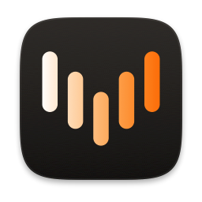

<div align="center">



<h1>Vocula</h1>

<p><b>Hold a key. Speak. The words appear where the caret is.</b><br>
Dictation for macOS that runs entirely on your Mac, in up to 100 languages.</p>

[](LICENSE)

[](https://github.com/vitaly-kashtalyan/vocula/releases/latest)
[](https://github.com/vitaly-kashtalyan/vocula/actions/workflows/ci.yml)

<a href="#install">Install</a> ·
<a href="#what-leaves-this-mac">Privacy</a> ·
<a href="#build-it-yourself">Build it yourself</a> ·
<a href="#known-limitations">Limitations</a> ·
<a href="PRIVACY.md">PRIVACY.md</a>

</div>

<!-- A screen recording of one dictation goes here, once there is one to record:
     hold the key, speak a sentence, watch it land in a text field. -->

There is no account and no sign-in, and nothing you dictate ever leaves this
Mac. The app talks to exactly two places, both on GitHub: it fetches the speech
model by itself at launch whenever it is missing (and the clean-up model, if you ask for it, and the speaker
separation model the first time you record a meeting), and — while you leave the
switch on — it asks once a day whether a newer version of Vocula exists. Your licence is checked here, offline.

## How it works

Hold <kbd>fn</kbd>, speak, release. The text is pasted at the caret, in whatever
application you were already typing in.

- Release inside 300 ms and the recording is discarded, so a brushed key costs
  nothing.
- <kbd>esc</kbd> cancels an open recording.
- <kbd>⌃</kbd><kbd>⇧</kbd><kbd>L</kbd> steps through the languages you selected,
  without opening a window.

That is the whole interface. There is no toggle mode and no double tap, because
one gesture that always works beats two where one sometimes does.

```
   you hold the key
          │
   [ AUHAL input ]        pinned to YOUR chosen device, not the system default
          │
   [ Silero VAD ]         CPU — finds where the speech is, or salvages a whisper
          │
   [ Parakeet ]           Neural Engine — the default when your languages are among its 25
    or [ whisper.cpp ]    Metal GPU — every language, 0.02–0.03× realtime, measured
                          on whisper.cpp 1.9.2
          │
   [ one line ]           newlines and tabs become spaces, so a paste cannot run
          │
   [ TextFilter ]         drops output that is nothing but *[Music]* tags
          │
   [ clean-up ]           optional, off by default — a local model removes filler;
          │               a lost number, "not" or question pastes the original
   [ TargetGuard ]        refuses password fields, and secure input raised mid-session
          │
   [ ⌘V ]                 your clipboard is put back a second later
          │
   the text is in your document
```

There is no network stage in that diagram, and that is the point.

## What leaves this Mac

Nothing you say. Ever.

| What | Where it happens |
| --- | --- |
| Audio capture | This Mac. The microphone opens on the record key and closes on release — except while you record a meeting, when it stays open until the meeting stops and records everything it hears, anything you dictate meanwhile included; the sound other apps play is recorded too, both kept on disk, AES-GCM encrypted, beside the encrypted transcript Vocula makes of them on this Mac after the meeting, until you delete the meeting. |
| Speech detection and transcription | This Mac — detection on the CPU; transcription on the Neural Engine with Parakeet, or the GPU with Whisper. A recorded meeting's call is also split into its speakers here, through Core ML. |
| Clean-up, if you switch it on | This Mac, on the GPU. The model sees the transcript and nothing else. |
| Dictation history | This Mac, AES-GCM encrypted, one file per day, kept a year. The key is in your login keychain. |
| Licence check | This Mac. An Ed25519 signature against a public key compiled into the binary. |
| Model download | This project's GitHub releases. The speech model is fetched by itself at launch whenever it is missing, waiting for a connection macOS does not mark as expensive or Low Data; the Models screen's button and the clean-up model download on request. The 19 MB speaker separation model is fetched by itself when a meeting starts recording and it is missing, over any connection but one in Low Data Mode, a personal hotspot included; it has no button. SHA-256 verified. |
| Update check | This project's GitHub releases, once a day, while the switch on Settings → Permissions is on. It asks whether a newer version exists and sends nothing about you. |

**Do not take that on trust — the repository is open in front of you.** Every
place the shipping app reaches the network is named in the files below, and
this is the command that proves there is no other:

```sh
git grep -l "URLSession\|SUFeedURL" -- App/Vocula App/project.yml Sources
# App/Vocula/Meeting/MeetingDiarizerFetcher.swift  the speaker separation model when a meeting starts and it is missing
# App/Vocula/Models/ModelDownloader.swift          the speech model by itself when missing, the clean-up model on request
# App/Vocula/Updates/UpdaterController.swift       reads SUFeedURL; Sparkle makes the request
# App/project.yml                                  SUFeedURL, the daily version check
```

That covers the code in this repository. The update check itself is performed
by [Sparkle](https://github.com/sparkle-project/Sparkle), pinned by commit in
`App/project.yml`, and it fetches one signed XML file from the same GitHub
releases the models come from.

No telemetry, no analytics, no crash reporting, no licence server. The
third-party components in the app are the two recognition engines — whisper.cpp
and FluidAudio — MLX and swift-transformers for the optional clean-up model, and Sparkle, every
one and every package they pull in pinned by exact version, commit or checksum
in `App/project.yml` and `Package.swift`, so there is no analytics SDK for a
call to hide in. One thing
the update check gives away by existing: GitHub counts downloads of every
release asset, so the number of copies asking is visible to anyone who looks —
including us. It is a count, and it is all it is.

The exceptions, stated rather than buried: Settings → Microphone opens the input
to draw a level meter, so you can see that it hears you before you rely on it —
macOS shows its orange dot for as long as it does, and the samples are measured
and dropped. *Record Meeting (Beta)* keeps the microphone open until the meeting
stops, records the sound other apps play through macOS's System Audio Recording
permission, and keeps both on disk, encrypted under their own key, beside the
encrypted transcript it makes of them on this Mac, until you delete the meeting
in *Meetings (Beta)*. The first
meeting you record, or any meeting started while it is missing, downloads the
speaker separation model from the same GitHub releases, which tells GitHub, from
your IP address, that a meeting is starting. While *Offer to record a call and
to stop when it ends* is on, as it is until you switch it off in *Meetings
(Beta)*, Vocula asks macOS every two seconds which apps use the microphone and
play sound — never what they hear or play — offers to record when one has done
both for ten seconds, and, while a meeting records, offers to stop it once every
app it took for a call during the recording has left the microphone for 30
seconds, or once nothing has been heard for two minutes — judged from the sound
levels the meeting already measures for its 15-minute stop, so nothing new is
read or stored. No offer acts by itself: nothing records until you choose
*Record*, and an offer to stop leaves the meeting recording until you choose
*Stop Recording*.
Insertion goes through the system pasteboard for about a second, which other
applications can read, and *Copy Transcript* puts a meeting's transcript there
as plain Markdown; *Export…* writes it to a file you choose. All four are in [PRIVACY.md](PRIVACY.md), at length,
along with what none of this protects you from.

## Install

Download the signed, notarised build from
[vocula.app](https://vocula.app), or [build it yourself](#build-it-yourself).
Drag Vocula into Applications and open it from there: a copy opened from the
disk image cannot update itself.

## Buying a build

The source builds into a working app. Nothing is held back and there is no
reduced edition; the licence check is in this repository like everything else —
`LicenceVerifier` and the trial that gates it are a few files you can read, and
delete.

What the paid build is, exactly: this source, compiled once, signed with a
Developer ID certificate and notarised by Apple.

Whether that is worth paying for is your call, but the difference is measurable
rather than a matter of taste. macOS binds Accessibility and Microphone to a
bundle id **and its signature**, and the encrypted history key is ACL'd to the
same signature. An ad-hoc signature changes on every build.

> [!IMPORTANT]
> A copy you compile yourself is signed ad-hoc, so macOS asks for Accessibility
> and Microphone again every time you rebuild it, and the history key does not
> survive a rebuild. Point `App/Local.xcconfig` at your own Apple team to stop
> that. It can still record a meeting: it gets its own System Audio Recording
> prompt and records (measured); whether a rebuild asks again is not measured.

Building it yourself is free, and of course always will be.
`App/Signing.xcconfig` ships ad-hoc by default precisely so that a stranger with
no Apple account can clone this repository and get a running app.

A build from source runs unlimited for thirty days, then ten inserted dictations
a day until a key is pasted into Settings → Licence. A dictation only counts
against that if the text actually reached your caret: a cancelled gesture, a
silent recording, a refusal and a dead microphone all cost nothing.

## Requirements

- macOS 26.0 or later.
- Disk for the speech model, which downloads by itself at first launch: about
  630 MB for Parakeet Ultra once installed (a 555 MB download that needs about
  1.2 GB free while it expands), or about 1.6 GB for Whisper
  Large v3 Turbo when one of your languages is outside Parakeet's 25 or macOS
  does not list them, plus the
  voice-activity detector either way; and about 1.5 GB more for the clean-up
  model, downloaded when you ask for it — by switching clean-up on, or with its
  `Load` button. Recording a meeting adds about 22 MB for the speaker separation
  model (a 19 MB download). A recorded meeting takes about 230 MB an hour, and that space
  stays taken until you delete the meeting in *Meetings (Beta)*: each of its two
  tracks is stored whole as 16 kHz mono 16-bit samples, the other apps' track
  through its silences too, which is about 115 MB per track per hour, computed
  from that format, not measured; the transcript beside it adds little. Transcribing holds a second
  copy of the recognition model in memory for as long as it runs, and while it
  splits a call into speakers up to about 0.8 GB more for a meeting of an hour
  (measured: 0.65 GB at 30 minutes, 0.77 GB at an hour); a meeting over two
  hours is not split.
- Three permissions, each asked for when it is first needed: **Accessibility**,
  which is what lets the record key be seen and swallowed outside our own
  window and lets ⌘V reach another application, **Microphone**, and **System
  Audio Recording**, asked the first time you record a meeting.

Apple Silicon only, and the binary is built for `arm64` alone. Recognition runs
on the GPU and the Neural Engine; an Intel Mac has neither in a form this can
use, so the answer there is not a slower build but a different product. That is
a choice, not a compiler limit: the project would build for `x86_64` too, and
is kept to `arm64` on purpose.

## Build it yourself

Xcode 27.2 or later — the package needs the Swift 6.2 toolchain and the macOS 26
SDK, and Xcode 26 builds a dependency's package trait without its compile
condition, which leaves FluidAudio's speaker separation out of the app. The
first build needs a network for its dependencies: Sparkle, pinned by commit in
`App/project.yml`; the whisper.cpp XCFramework, fetched from the
GitHub build page its release names and checked against the SHA-256 pinned in
`Package.swift`; and
FluidAudio, pinned to an exact tag there, which itself fetches a prebuilt
text-normalisation XCFramework against its own checksum, which this build does
not link; and MLX with
swift-transformers, each package pinned by commit in `App/project.yml`.
MLX compiles its Metal kernels from source, which needs Xcode's separately
installed Metal Toolchain, and mlx-swift ships a build-tool plugin that
`xcodebuild` refuses to run unless told to trust it.

```sh
brew install xcodegen                       # once
xcodebuild -downloadComponent MetalToolchain  # once
(cd App && xcodegen generate)               # required on a fresh clone
xcodebuild -project App/Vocula.xcodeproj -scheme Vocula -configuration Debug \
  -skipPackagePluginValidation build
```

Hooks are tracked but not installed by cloning — `git config core.hooksPath .githooks`
turns them on. They format Swift and refuse a String Catalog that some other JSON
tool has rewritten. Skipping this costs nothing: CI runs the same checks.

`App/Vocula.xcodeproj` is generated and is not in the tree, so the second line is
not optional. Signing is ad-hoc by default; point `App/Local.xcconfig` at your
own team to get a stable signature — see `App/Local.xcconfig.example`.

`./scripts/install-local.sh` builds a Debug copy and installs it into
`/Applications`, in the order that avoids leaving a running app's pages under a
replaced bundle.

### Tests

```sh
swift test                       # the kit and both engines — no app, no hardware
./scripts/check-purity.sh        # VoculaKit must import Foundation only
./scripts/check-localization.sh  # every key has a translator comment
xcodebuild test -project App/Vocula.xcodeproj -scheme Vocula \
  -skipPackagePluginValidation -only-testing:VoculaAppTests
```

1762 tests: 1340 from `swift test` (the sum of the totals it prints, one per test
target), 395 in the hosted app bundle, 27 driving the real interface. The UI tests are opt-in with `TEST_RUNNER_VOCULA_UI_TESTS=1` because
they take over the screen, and `TEST_RUNNER_VOCULA_UI_LANG=de` runs the same
suite against a translated interface, which is the run that catches layout. Two of
the 27 check English copy and skip whenever a language is set, so a run without
one is the only run that executes them.

`swift test` never compiles `App/`, so a green run says nothing about whether the
app builds.

## Known limitations

Stated here rather than discovered later.

- **Moving from Parakeet v3 to Parakeet Ultra leaves the old model behind.**
  Someone who used Parakeet v3 finds Parakeet Ultra selected, and it downloads
  by itself, 555 MB; Whisper, if it is on disk, dictates meanwhile. The app never
  deletes
  `~/Library/Application Support/app.vocula.mac/Models/parakeet-tdt-0.6b-v3/`
  (about 470 MB) or a `parakeet-tdt-0.6b-v3.zip` left beside it; delete them by
  hand once Ultra works.
- **An update moves you to Parakeet Ultra unless you picked an engine, or speak
  a language it cannot hear.** If you never chose an engine on Settings → Models,
  this version chooses one from your languages at its first launch: when all of
  them are among Parakeet's 25, it selects Parakeet Ultra and downloads it by
  itself, 555 MB. Whisper keeps dictating until Ultra arrives and then stays on
  disk (1.62 GB); the app never deletes it. Parakeet spells an English term
  inside Russian or Ukrainian speech in Latin only some of the time, and never
  when one language is pinned; for mixed technical speech Whisper is the better
  engine. To go back, pick Whisper on Settings → Models.
- **A Parakeet Ultra that will not load on your Mac is replaced by Whisper.** The
  app deletes it, selects Whisper — which hears every language — and downloads
  Whisper by itself (1.6 GB) when it is not on disk — at the next launch if the
  clean-up model is downloading. It stays on Whisper, even if
  you had picked Ultra, until you pick Ultra again on Settings → Models.
- **A dictation in progress when a model the app downloaded by itself arrives
  can be lost.** Recognition restarts on the new model, waiting at most three
  seconds for a dictation still in flight.
- **The automatic download does not say when it is waiting or has given up.**
  On an iPhone hotspot, with Low Data Mode or with no network, Status reads
  "downloading 0%" until ordinary Wi-Fi or Ethernet returns. A transfer that
  keeps failing — a lost network or a server error — stops after four attempts
  until the next launch; with too little free disk it does not start at all; and
  a file that fails its checksum or will not expand is deleted and downloaded
  again in full at every launch. Neither reaches the screen; Settings →
  Diagnostics records both, and "Download what is missing" on Settings → Models
  shows the error.
- **Turning clean-up off after its progress bar has filled does not undo the
  download.** Off while the downloaded archive is being moved into place and
  checksummed leaves the 1.49 GB archive at
  `~/Library/Application Support/app.vocula.mac/Models/vocula-cleanup-2b-v1.zip`;
  turning clean-up on again deletes it and downloads all of it again. Off once
  expansion has started leaves the finished 1.56 GB model in
  `vocula-cleanup-2b-v1/` and removes the archive. While clean-up stays off,
  nothing in the app removes either; delete them by hand.
- **One of dictation's models downloads at a time.** While the speech model's automatic
  download waits for a good network or runs, turning clean-up on starts nothing
  and its `Load` is greyed out; Settings → Models' Cancel releases it, and `Load`
  fetches the clean-up model once the downloader is free. Turning
  clean-up on first holds the speech model back until the 1.49 GB clean-up model
  is done or you turn clean-up off; the speech model then downloads at the next
  launch, or with "Download what is missing" on Settings → Models. The speaker
  separation model has a downloader of its own, which starts when a meeting
  starts and can run beside these.
- **A language Parakeet cannot hear, missing from your Mac's language list,
  lands you on Parakeet.** The engine is chosen from the languages ticked in
  Vocula and the ones listed in System Settings → Language & Region. Someone on
  an English Mac who speaks Japanese — or another language outside Parakeet's
  25 — starts on Parakeet, and that language is absent from Languages until
  Whisper is picked on Settings → Models; it then downloads with "Download what is
  missing", or by itself at the next launch.
- **A copy run from its disk image, or from the folder it was downloaded to,
  never updates.** The updater refuses to replace an app on a read-only volume —
  the mounted disk image, or the read-only copy macOS runs a downloaded app from
  until the Finder has moved it — and such a copy does not even ask whether a
  newer version exists. Settings → Permissions says so at the top. Quit Vocula,
  drag it by itself into Applications in the Finder (if it is already there, drag
  it out and back in), and open it from there.
- **Record Meeting is a beta.** After a meeting ends, Vocula transcribes it on
  this Mac into lines labelled *Me* (your microphone, however many people sit at
  it) and *Speaker 1*, *Speaker 2*… (the people in what other apps played,
  numbered in the order they first spoke and told apart on this Mac) — a line no
  single speaker can be given, two people at once, reads *Others*, and so does the
  whole call when the separation fails, takes too long, or the meeting ran over
  two hours. Speech the model misses is missing from the transcript, and so is a reply
  of yours that repeats, two words or more in a row, what the other side just
  said, which is dropped as echo; what you dictate during it is left out. A meeting ended by quitting Vocula, or one whose transcription a quit
  interrupted, is transcribed after the next meeting you record ends. A meeting
  that ends before the speaker separation model has arrived shows as not
  transcribed, under a line saying how much of the model has arrived, and is
  transcribed as soon as the model arrives — it is fetched when
  a meeting starts, over any connection, a personal hotspot included, but never
  in Low Data Mode; if 24 hours pass first, the next meeting's end transcribes it with *Others*. A copy of that model that will not load is
  deleted and fetched again at the next meeting's start, once per launch.
  *Meetings (Beta)*, in the window below *Clean-up*, lists every meeting it can
  open and
  opens, renames, pins, exports as Markdown, copies and deletes one; a pinned
  meeting cannot be deleted. *Copy Transcript* in the menu copies a transcript
  as Markdown, with or without your own lines (*Include My Lines*); after Vocula
  restarts it is absent until you open *Meetings (Beta)* or record a meeting,
  because the meeting key is not read before then. A meeting keeps its
  recording, encrypted, until you delete it, and is transcribed once: this
  version cannot play a meeting back or transcribe it again. A
  Bluetooth headset's or an iPhone's microphone is never recorded in a meeting:
  when dictation uses one, the meeting records other apps alone.
- **A meeting keeps the Mac awake.** While one records, Vocula holds an
  assertion against idle sleep, `vocula.meeting` in `pmset -g assertions`;
  closing the lid or choosing Sleep still sleeps the Mac, and ends the meeting.
  A meeting stops by itself only after 15 minutes in which nothing was heard,
  and any sound from any app counts, however faint — so a meeting forgotten
  beside music or a video keeps the Mac awake until you choose *Stop Meeting*.
- **A licence cannot be revoked individually.** Verification is offline, so
  there is no server to ask — which is the whole point, and the cost is that a
  refund leaves a working key.
- **A dictated command lands at a shell prompt; it does not run itself.** The
  transcript is folded to one line before it is pasted — and so is whatever the
  clean-up model returns — so nothing in it carries a Return. A modal editor is the exception that remains: in vim's normal mode
  the letters are commands, and what protects you there is the terminal's
  bracketed paste rather than anything this app does. Measured: Terminal.app
  performs it, tmux does not.
- **Word counts split on whitespace**, which is honest for the languages this
  has been measured in and wrong for Chinese.
- **The interface is translated into nine languages and reviewed in one.**
  English is the source; German, Spanish, French, Italian, Polish, Portuguese
  (Brazil), Russian and Ukrainian are complete drafts waiting on a native
  reader. Correcting one is the single most useful thing you could send.

## Where things are

| Path | What lives there |
| --- | --- |
| `Sources/VoculaKit` | Every decision. Foundation only, enforced by a script. All of it tested. |
| `Sources/VoculaWhisper` | Adapters over the pinned whisper.cpp XCFramework. |
| `Sources/VoculaParakeet` | Adapters over FluidAudio, which runs Parakeet on the Neural Engine and separates a meeting's speakers. |
| `App/` | Event taps, audio, Accessibility, pasteboard, UI. |

Most of `App/` has no fast automated tests by design: it touches hardware. When
something breaks there, the fix is usually to move the *decision* into
`VoculaKit` and test it. Most of what lives in the kit arrived that way.

## Open source, but not open contribution

Pull requests are not accepted, and that is a policy rather than a backlog: a
merged patch leaves its author's copyright in the tree, which ends any
possibility of relicensing work whose binary is sold. A fork-and-close workflow
would be dishonest about that, so it is said here, before anyone does the work.

What is genuinely wanted: bug reports, measurements that contradict something
this README claims, a correction to one of the eight unreviewed translations,
and anything about a language. Open an issue.

Forking is free and needs no permission. Your fork stays GPL-3.0.
Security problems go through [SECURITY.md](SECURITY.md), not a public issue.

## Licence

Copyright © 2026 Vitali Kashtalyan.

Vocula is free software: you may redistribute it and modify it under the terms
of the **GNU General Public License, version 3**, as published by the Free
Software Foundation. It is distributed in the hope that it will be useful, but
WITHOUT ANY WARRANTY — without even the implied warranty of MERCHANTABILITY or
FITNESS FOR A PARTICULAR PURPOSE. The full text is in [LICENSE](LICENSE), and
a copy travels inside every build.

There are no per-file copyright headers, deliberately. The licence is stated
here and in `LICENSE`, which is what makes it binding; over three hundred files of boilerplate
would add nothing legally and would contradict the rule this codebase is built
on, that a comment must earn its place.

The third-party components Vocula is built on carry their own licences, which
are reproduced in full in `App/Vocula/Licenses/THIRD-PARTY.txt` and are
reachable from Settings → Models inside the app.
